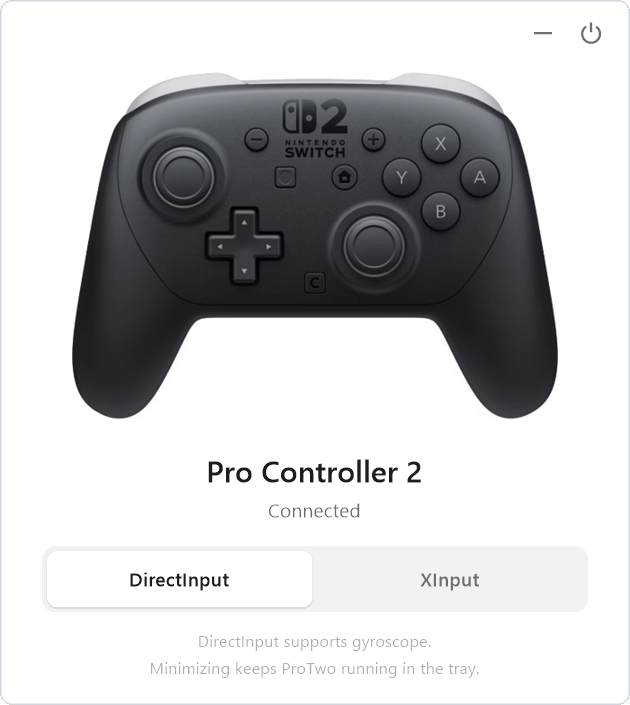

<p align="center">
  
</p>

<h1 align="center">ProTwo 1.0</h1>

<p align="center">Makes the Nintendo Switch 2 Pro Controller usable over USB on Windows, through DirectInput or XInput.</p>

<p align="center">
  
</p>

## Prerequisite

- The [ViGEmBus](https://github.com/nefarius/ViGEmBus/releases/latest) driver
- ProTwo offers to open its download page if it is missing

## Install

1. Install [ViGEmBus](https://github.com/nefarius/ViGEmBus/releases/latest)
2. Download `protwo.exe` from the [latest release](../../releases/latest) and run it
3. Plug in the controller over USB

Windows 10 or 11, 64-bit.

## Use

- **DirectInput**: games see a DualShock 4, with gyroscope
- **XInput**: games see an Xbox 360 controller, without gyroscope
- Minimize the app and find it in your tray

## Limits

- USB only
- One controller at a time

## Build

```bash
cargo build --release
```

See [architecture](docs/ARCHITECTURE.md) and [protocol notes](docs/PROTOCOL.md).

## Credits

- [SDL](https://github.com/libsdl-org/SDL)
- [ndeadly/switch2_controller_research](https://github.com/ndeadly/switch2_controller_research)
- The Linux `hid-switch2` driver
- [HandHeldLegend's procon2tool](https://handheldlegend.github.io/procon2tool/)
- [ViGEmBus](https://github.com/nefarius/ViGEmBus)

Not affiliated with Nintendo, Sony or Microsoft.

## License

[MIT](LICENSE)
